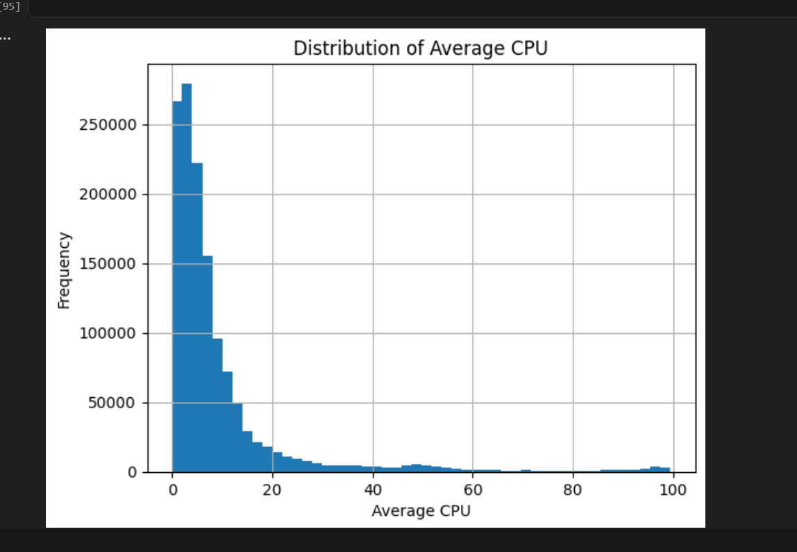
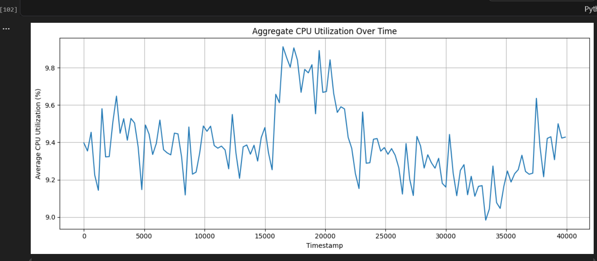
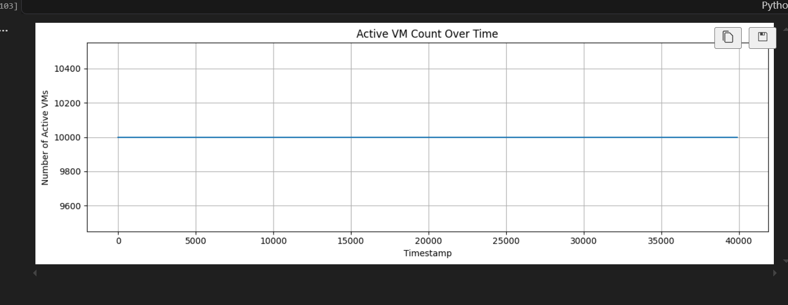

# Cloud Workload Forecasting & Analysis

A time-series forecasting project that analyzes Azure virtual machine workloads and predicts **active VM count** and **aggregate CPU utilization** using historical workload data.

## Project Overview

This project uses CPU readings from 10,000 Azure virtual machines to understand workload patterns and forecast future resource demand. It includes exploratory data analysis, preprocessing, baseline forecasting, Gradient Boosting experiments, recursive forecasting, and model evaluation.

## Key Features

- Exploratory Data Analysis (EDA)
- CPU utilization distribution and workload trend analysis
- Timestamp-level workload aggregation
- Time-aware training and holdout split
- Lag-based feature engineering
- Persistence baseline and Gradient Boosting comparison
- Recursive forecasting for 24 future timestamps
- Model evaluation using MAE, MSE, and RMSE
- Export predictions to `predictions.csv`

## Technologies Used

- Python
- Pandas
- NumPy
- Scikit-learn
- Matplotlib
- Joblib
- Jupyter Notebook

## Dataset

The dataset is based on a curated subset of the Microsoft Azure Public Dataset V2.

| Property | Description |
|---|---|
| Virtual machines | 10,000 |
| Readings per VM | 134 |
| Total VM-level observations | 1,340,000 |
| Sampling interval | 5 minutes |
| Observation window | Approximately 11.1 hours |

The dataset contains CPU utilization readings and virtual machine metadata.

## Forecasting Targets

- **`active_vm_count`** — The number of unique virtual machines observed at each timestamp.
- **`aggregate_cpu_utilization`** — The mean of the VMs' average CPU utilization at each timestamp, expressed as a percentage.

## Exploratory Data Analysis

EDA is used to understand CPU utilization distributions, workload changes, and VM activity over time.

### Average CPU Utilization Distribution



### Aggregate CPU Utilization Over Time



### Active VM Count Over Time



## Forecasting Approach

The forecasting workflow follows these steps:

1. Load and inspect the VM readings and metadata.
2. Aggregate VM-level observations into timestamp-level forecasting targets.
3. Sort observations chronologically.
4. Use the first 110 timestamps as the historical training period.
5. Reserve the final 24 timestamps for holdout evaluation.
6. Create lag features from historical workload values.
7. Train and compare forecasting models.
8. Generate forecasts recursively, feeding each prediction into the next step's lag features.
9. Evaluate predictions against the actual values in the holdout period.

The holdout targets must not be used for model fitting, feature construction, or model selection.

## Models

### Persistence Baseline

The persistence baseline uses the most recently observed value as the forecast. It provides a simple reference point for evaluating whether more complex models improve forecasting accuracy.

### Gradient Boosting Regressor

Gradient Boosting was tested with lag-based features, and several hyperparameter configurations were explored. Some configurations showed promising results during model experimentation. However, the final holdout evaluation showed that the persistence baseline performed better for aggregate CPU utilization.

## Model Evaluation

The models were evaluated on the same final 24-timestamp holdout period using MAE, MSE, and RMSE.

- **MAE (Mean Absolute Error):** Measures the average absolute difference between actual and predicted values.
- **MSE (Mean Squared Error):** Measures the average squared prediction error.
- **RMSE (Root Mean Squared Error):** Gives greater weight to larger prediction errors.

### Final Holdout Results

| Model | Forecasting Target | MAE | MSE | RMSE |
|---|---|---:|---:|---:|
| Persistence Baseline | Active VM Count | 0.0000 | 0.0000 | 0.0000 |
| Gradient Boosting | Active VM Count | 0.0000 | 0.0000 | 0.0000 |
| Persistence Baseline | Aggregate CPU Utilization | 0.1468 | 0.0341 | 0.1848 |
| Gradient Boosting | Aggregate CPU Utilization | 0.1664 | 0.0397 | 0.1992 |

### Results Interpretation

- **Active VM count:** Both models achieved zero error during the holdout evaluation. Check whether the count remained constant throughout the evaluated period.
- **Aggregate CPU utilization:** The persistence baseline achieved lower MAE and RMSE than Gradient Boosting in the final evaluation.
- **Model selection:** A more complex model is not necessarily better than a simple baseline, particularly when only a short historical time series is available.

The final comparison should use the same holdout timestamps and forecasting procedure for every model.

## Prediction Output

The final output file is `predictions.csv`.

It must contain exactly these columns, in this order:

```csv
timestamp,active_vm_count,aggregate_cpu_utilization
```

The output must satisfy the following requirements:

- Exactly 24 forecast rows
- Chronological timestamps matching the final 24 dataset timestamps
- No duplicate or missing timestamps
- Finite numeric predictions
- Non-negative active VM counts
- CPU utilization predictions between 0 and 100
- No extra CSV index column

## Project Structure

```text
forecasting-challenge/
├── data/
│   ├── DATA_CARD.md
│   ├── vm_cpu_readings.csv
│   └── vm_metadata.csv
├── models/
│   └── gradient_boosting.pkl
├── notebooks/
│   ├── EDA.ipynb
│   ├── baseline_model.ipynb
│   └── test_models.ipynb
├── reports/
│   └── final_report.md
├── src/
│   ├── preprocessing.py
│   ├── train.py
│   └── predict.py
├── predictions.csv
├── requirements.txt
└── README.md
```

## Installation

### 1. Clone the Repository

```bash
git clone https://github.com/NisarAhmad7/forecasting-challenge.git
cd forecasting-challenge
```

### 2. Create a Virtual Environment

```bash
python -m venv .venv
```

### 3. Activate the Environment

**Windows:**

```bash
.venv\Scripts\activate
```

**Linux / macOS:**

```bash
source .venv/bin/activate
```

### 4. Install Dependencies

```bash
pip install -r requirements.txt
```

## Usage

Run these commands if they match the interfaces implemented in your scripts.

### Train the Model

```bash
python src/train.py
```

### Generate Predictions

```bash
python src/predict.py
```

After generating predictions, verify that `predictions.csv` contains the expected columns and 24 correctly ordered forecast rows.

## Reproducibility and Future Improvements

Potential improvements include:

- Compare against moving-average and seasonal-naive baselines where appropriate.
- Use chronological validation within the training period for model selection.
- Experiment with different lag lengths and carefully selected time-based features.
- Add automated checks for forecast shape, timestamps, missing values, and valid prediction ranges.
- Re-run the final comparison using a fixed model configuration and identical evaluation procedures.

## Limitations

- The dataset covers approximately 11.1 hours, limiting analysis of daily or weekly seasonality.
- Only 110 timestamp-level observations are available before the holdout period, and lag features reduce the number of training examples further.
- Recursive forecasting can accumulate errors because earlier predictions become inputs to later steps.
- The workload patterns in this dataset may not represent every Azure environment or longer-term production behavior.

## Author

**Nisar Ahmad Zamani**

- GitHub: [NisarAhmad7](https://github.com/NisarAhmad7)
- LinkedIn: [Nisar Ahmad Zamani](https://www.linkedin.com/in/nisar-ahmad-zamani-440769436/)
