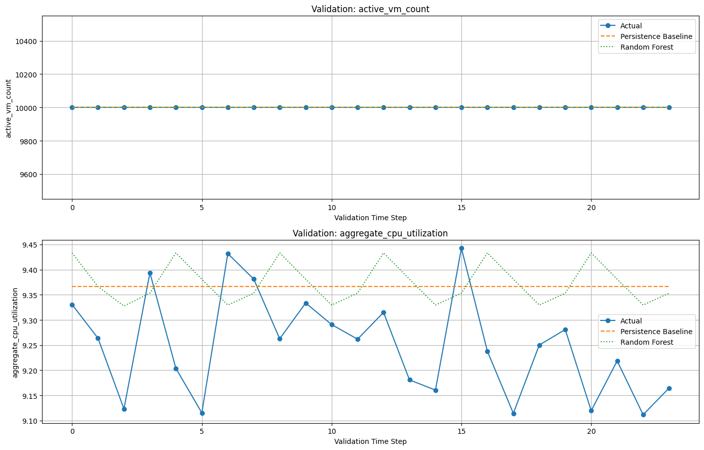
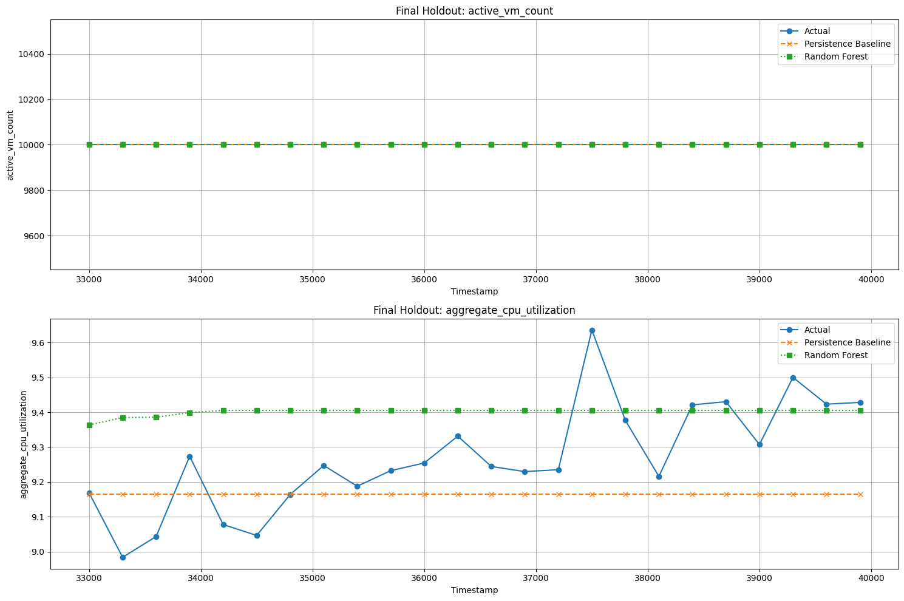

# Cloud Workload Forecasting & Analysis

## Final Project Report

**Author:** Nisar Ahmad Zamani  
**Project:** Cloud Workload Forecasting & Analysis  
**Dataset:** Azure VM Workload Dataset — Microsoft Azure Public Dataset V2 subset  
**Primary Model:** Gradient Boosting with Multi-Output Regression

---

## 1. Executive Summary

This project investigates short-term cloud workload forecasting using CPU utilization data from Azure virtual machines. The objective is to analyze historical workload patterns and predict two metrics: active virtual machine count and aggregate CPU utilization.

The workflow includes exploratory data analysis (EDA), data preprocessing, chronological train-test splitting, lag-based feature engineering, baseline forecasting, machine learning, model experiments, and model evaluation.

A Persistence Baseline was compared with a Gradient Boosting model using Mean Absolute Error (MAE), Mean Squared Error (MSE), and Root Mean Squared Error (RMSE).

During model experimentation, different Gradient Boosting configurations were tested. One configuration produced promising CPU forecasting results, demonstrating that hyperparameter selection can influence model performance. However, in the final holdout evaluation reported here, the Persistence Baseline performed better than the selected Gradient Boosting model for aggregate CPU utilization.

Both approaches achieved zero error for active VM count during the evaluated holdout period. These results demonstrate that a more complex machine learning model does not necessarily outperform a simple forecasting baseline.

## 2. Project Objectives

The main objectives of this project are to:

- Analyze historical Azure VM CPU workload data.
- Understand CPU utilization distributions and workload changes over time.
- Aggregate VM-level readings into timestamp-level forecasting targets.
- Prevent data leakage through chronological data splitting and past-only features.
- Establish a Persistence Baseline for comparison.
- Train and evaluate a Gradient Boosting forecasting model.
- Experiment with different Gradient Boosting hyperparameters.
- Generate forecasts for the final 24 timestamps.
- Compare model performance using MAE, MSE, and RMSE.
- Identify limitations and propose improvements.

## 3. Dataset Description

The dataset is based on a curated subset of the Microsoft Azure Public Dataset V2.

| Dataset characteristic | Description |
|---|---|
| Virtual machines | 10,000 |
| CPU readings per VM | 134 |
| Total VM-level observations | 1,340,000 |
| Sampling interval | 5 minutes |
| Observation window | Approximately 11.1 hours |
| Main input file | `vm_cpu_readings.csv` |
| Metadata file | `vm_metadata.csv` |

The CPU readings contain timestamps, VM identifiers, and CPU utilization measurements. The metadata file contains additional information about virtual machines.

### 3.1 Forecasting Targets

The project forecasts two target variables:

- **`active_vm_count`:** Number of unique virtual machines observed at each timestamp.
- **`aggregate_cpu_utilization`:** Mean of the VMs' average CPU utilization at each timestamp, expressed as a percentage.

These targets describe different aspects of workload behavior. Active VM count measures observed VM activity, while aggregate CPU utilization represents the average CPU usage across the observed VMs.

## 4. Exploratory Data Analysis (EDA)

Exploratory Data Analysis was used to understand the dataset's structure, CPU utilization distribution, and workload behavior over time.

The analysis included examining dataset dimensions, data types, missing values, descriptive statistics, CPU utilization distributions, and timestamp-level workload trends.

### 4.1 Average CPU Utilization Distribution

This histogram illustrates the distribution of average CPU utilization across the VM-level readings.


*Figure 1. Distribution of average CPU utilization.*

### 4.2 Aggregate CPU Utilization Over Time

This figure shows how aggregate CPU utilization changes across the observed timestamps.


*Figure 2. Aggregate CPU utilization over time.*

### 4.3 Active VM Count Over Time

This figure shows the number of unique virtual machines observed at each timestamp.


*Figure 3. Active VM count over time.*

### 4.4 EDA Summary

The EDA provides a foundation for understanding the data before modeling. Timestamp-level aggregation makes the workload series suitable for forecasting. The relatively short observation window, however, limits conclusions about long-term trends and daily or weekly seasonality.

## 5. Data Preprocessing and Leakage Prevention

The preprocessing pipeline prepares the raw data for time-series forecasting.

### 5.1 Target Construction

VM-level readings are grouped by timestamp to calculate the two forecasting targets:

- Count the unique VM identifiers to obtain `active_vm_count`.
- Calculate the mean of `avg_cpu` to obtain `aggregate_cpu_utilization`.

The resulting target series is sorted chronologically.

### 5.2 Chronological Train-Test Split

The 134 timestamps are divided into two periods:

| Period | Number of timestamps | Purpose |
|---|---:|---|
| Training history | 110 | Model fitting and historical features |
| Final holdout | 24 | Final forecasting evaluation |

The final 24 timestamps are kept separate from model fitting and forecast feature construction.

### 5.3 Lag-Based Feature Engineering

The preprocessing pipeline uses lag features from the previous observations of both targets. The current implementation uses lags of 1, 2, and 3 time steps.

These features allow the model to learn relationships between recent workload history and future target values.

Because the first three training rows do not have enough historical observations to construct all lag features, those rows are excluded from the lag-based training dataset.

### 5.4 Preventing Data Leakage

The following practices are used to reduce data leakage:

1. Sort the target series chronologically.
2. Separate the final 24 timestamps before creating training features.
3. Build training lag features using previous observations only.
4. Keep the actual holdout targets out of model fitting and recursive forecast features.
5. Feed each prediction into the history used to forecast the next time step.

During recursive forecasting, the model predicts one future time step at a time. Each prediction is added to the available history and used to construct features for the next step.

The actual holdout targets are used only after forecasting, to calculate evaluation metrics.

## 6. Forecasting Methodology

### 6.1 Persistence Baseline

The Persistence Baseline predicts that the next value will equal the most recently observed value.

This simple approach provides a reference point for determining whether the machine learning model adds value.

For the recursive 24-step forecast, the last available training observation is repeated across the forecast horizon.

### 6.2 Gradient Boosting Model

The primary machine learning model is a `GradientBoostingRegressor` wrapped in `MultiOutputRegressor` from scikit-learn.

The configuration documented in the original training script is:

| Parameter | Value |
|---|---|
| Loss | `squared_error` |
| Learning rate | `0.001` |
| Number of estimators | `300` |
| Maximum depth | `3` |
| Subsample | `0.8` |
| Random state | `42` |

The multi-output wrapper trains a separate Gradient Boosting regressor for each target.

The model is fitted on the lag-based training features and predicts the next 24 timestamps recursively. The trained model is saved as `models/gradient_boosting.pkl` using Joblib.

### 6.3 Gradient Boosting Experiments and Hyperparameter Tuning

Several Gradient Boosting configurations were tested to investigate whether changing the learning rate, number of trees, tree depth, and minimum samples per leaf could improve CPU forecasting.

The following results were recorded during the model experiments:

| Learning Rate | Estimators | Max Depth | Min Samples per Leaf | CPU MAE | CPU RMSE |
|---:|---:|---:|---:|---:|---:|
| 0.01 | 100 | 2 | 3 | 0.1484 | 0.1749 |
| 0.03 | 200 | 2 | 3 | 0.1113 | 0.1327 |
| 0.05 | 200 | 1 | 5 | 0.1213 | 0.1399 |
| 0.05 | 300 | 3 | 2 | 0.1453 | 0.1701 |

Among these recorded experiments, the configuration with a learning rate of `0.03`, 200 estimators, a maximum depth of `2`, and a minimum of `3` samples per leaf achieved the lowest reported CPU MAE and RMSE.

This experiment showed that Gradient Boosting performance was sensitive to its hyperparameters. The results were promising for that configuration.

However, these experimental results differ from the final holdout results reported in Section 7. The experimental scores should not be treated as the final model's performance unless they were obtained using the same final model, timestamps, and forecasting procedure. The discrepancy should be checked to ensure that the final report is reproducible.

### 6.4 Forecasting Workflow

The overall workflow is:

1. Load the VM readings and metadata.
2. Construct and sort the timestamp-level targets.
3. Split the data chronologically.
4. Create lag features from historical targets.
5. Train the Gradient Boosting model.
6. Experiment with alternative hyperparameter configurations using training and validation data.
7. Generate recursive forecasts for the final 24 timestamps.
8. Generate Persistence Baseline predictions for the same timestamps.
9. Compare predictions against actual holdout values.
10. Save the required forecast output and evaluation results.

## 7. Model Evaluation

The models were compared using three metrics:

- **MAE (Mean Absolute Error):** Measures the average absolute difference between actual and predicted values.
- **MSE (Mean Squared Error):** Calculates the average squared prediction error.
- **RMSE (Root Mean Squared Error):** Square root of MSE, expressed in the same units as the target.

For all three metrics, lower values indicate smaller prediction errors.

### 7.1 Final Holdout Results

The following table reports the final holdout evaluation results.

| Model | Target | MAE | MSE | RMSE |
|---|---|---:|---:|---:|
| Persistence Baseline | `active_vm_count` | 0.0000 | 0.0000 | 0.0000 |
| Persistence Baseline | `aggregate_cpu_utilization` | 0.1468 | 0.0341 | 0.1848 |
| Gradient Boosting | `active_vm_count` | 0.0000 | 0.0000 | 0.0000 |
| Gradient Boosting | `aggregate_cpu_utilization` | 0.1664 | 0.0397 | 0.1992 |

### 7.2 Validation Comparison

The validation comparison visualizes actual values alongside the Persistence Baseline and Gradient Boosting predictions over the validation period.



*Figure 4. Validation-period comparison of actual and predicted workload values.*

### 7.3 Final Holdout Comparison

The final holdout comparison visualizes actual values alongside the Persistence Baseline and Gradient Boosting forecasts over the final 24 timestamps.



*Figure 5. Final holdout comparison of actual values and forecasts.*

**Note:** Ensure that the comparison charts exist with the filenames shown above, or update the image paths to match the actual filenames in the `images/` directory.

### 7.4 Results Interpretation

#### Active VM Count

Both the Persistence Baseline and Gradient Boosting achieved MAE, MSE, and RMSE values of zero for `active_vm_count`.

This means that both sets of predictions matched the actual active VM counts in the evaluated period. The result should be interpreted alongside the actual target series to verify whether the count remained constant throughout the holdout period.

Since both models achieved the same metrics, Gradient Boosting did not demonstrate an improvement for this target.

#### Aggregate CPU Utilization

For aggregate CPU utilization, the Persistence Baseline achieved an MAE of 0.1468 and an RMSE of 0.1848. Gradient Boosting achieved an MAE of 0.1664 and an RMSE of 0.1992.

The baseline also achieved a lower MSE. Therefore, the Persistence Baseline outperformed Gradient Boosting across all three reported metrics for this holdout evaluation.

The baseline's MAE was approximately 11.8% lower than the Gradient Boosting MAE in this final comparison.

These findings indicate that the most recently observed CPU utilization was a stronger forecasting reference than the predictions produced by the Gradient Boosting configuration used for this final evaluation.

#### Main Finding

Gradient Boosting showed promising results during hyperparameter experiments, but the final holdout evaluation did not confirm an improvement over the Persistence Baseline.

This distinction is important: an experimental configuration may perform well in one evaluation, but the selected model must be judged using a consistent validation procedure and a final holdout evaluation that has not been used for model selection.

The final results show that model selection should be based on measured forecasting performance rather than algorithm complexity.

## 8. Error Analysis and Recommendations

### 8.1 Error Analysis

The evaluation results suggest that the Persistence Baseline is a strong reference for this dataset and forecast horizon.

Possible reasons why Gradient Boosting did not outperform the baseline include:

- The short observation window provides limited historical information.
- Lag features may not capture all temporal patterns.
- Recursive forecasting can propagate prediction errors across future steps.
- The selected model configuration may not be optimal for this dataset.

These are possible explanations rather than confirmed causes and should be investigated through further experiments.

The zero error for `active_vm_count` should also be checked against the actual target values to confirm that the count remained constant during the holdout period.

The difference between the experimental Gradient Boosting results and the final holdout results should be investigated by confirming that the same parameters, test timestamps, target values, and recursive forecasting procedure were used.

### 8.2 Recommendations

Future experiments could investigate:

1. Alternative lag combinations and rolling-window statistics.
2. Additional time-series forecasting approaches.
3. Hyperparameter tuning using only the training and validation periods.
4. Forecast errors at each horizon step to determine whether accuracy decreases further into the future.
5. Additional workload data covering longer periods, if available.

Any model selection and tuning should use only training and validation data. The final holdout should remain untouched until the final evaluation.

## 9. Prediction Output

The final forecast file is `predictions.csv`.

It must contain exactly these columns in this order:

```csv
timestamp,active_vm_count,aggregate_cpu_utilization